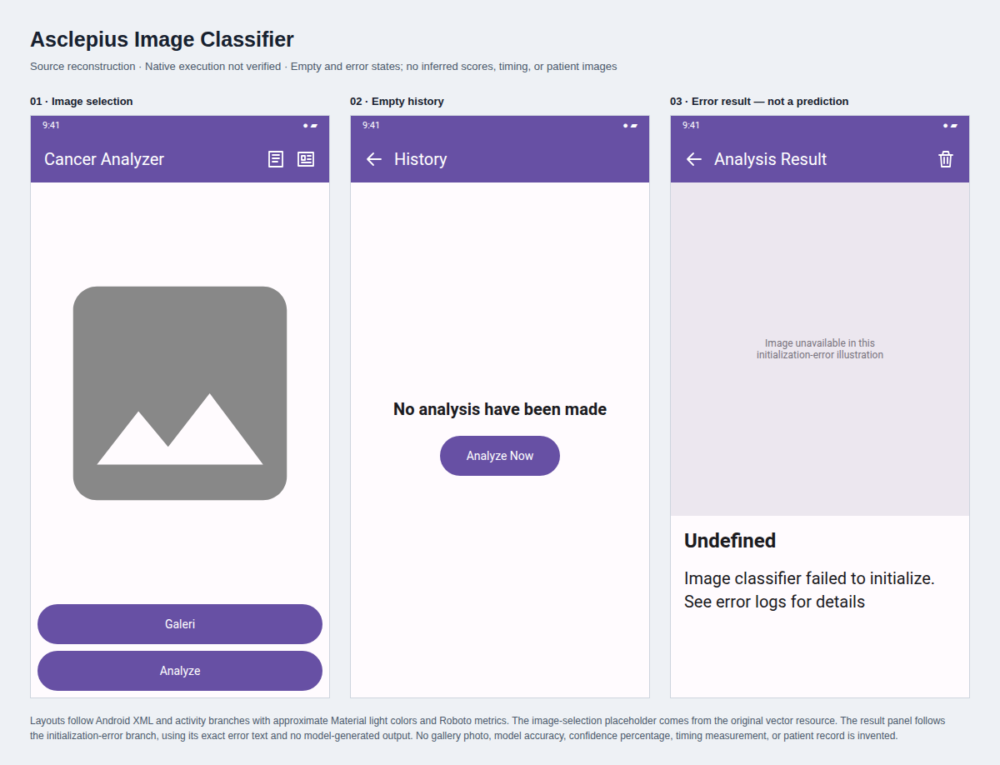
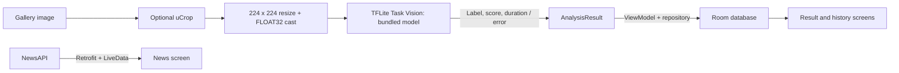

# Asclepius Image Classifier

An educational Android image-classification app built from a Dicoding course
starter. Select a gallery image, optionally crop it, run the bundled TensorFlow
Lite model, and inspect or delete saved analysis records. A separate news screen
uses NewsAPI. Model training and clinical validation are outside this repository.

## Interface



Source-based reconstructions, not device screenshots. The result panel illustrates
the source's initialization-error branch. It shows no fabricated prediction,
confidence, timing, patient image, or analysis history.
[Inspect the editable visual](docs/ui-preview.html).

## Mechanism



The model metadata labels are `Non Cancer` and `Cancer`. The helper selects GPU
when supported, otherwise NNAPI on Android 8.1+, otherwise four CPU threads.
Results include an image URI, label, integer score percentage, inference duration,
timestamp, and optional error. Room exposes history in descending record-ID order.
These model scores are not evidence of diagnostic accuracy.

## Run locally

Use Android SDK 34, JDK 17, and the included Gradle 8.2.1 wrapper.

```sh
./gradlew assembleDebug
# Install app/build/outputs/apk/debug/app-debug.apk on Android 7.0+
```

For the optional news screen, add your own key to ignored `local.properties`:

```properties
NEWS_API_KEY=your_key_here
```

The build configuration accepts an empty key; news requests need a valid key.
Android Studio can configure the local SDK path. No credentials are bundled.

## Provenance and limits

One app-related submission commit was retained from a private course workspace.
Extraction changed its hash while preserving author, dates, and message, with a
GitHub noreply email. A separate preparation commit adds documentation, the missing
wrapper, and matching Kotlin/KSP versions.

The native build attempt timed out after 180 seconds before task results; no APK,
inference, or device behavior was verified. Analysis is invoked through
`runBlocking` on the activity thread. Image references point into cache storage,
and the timestamp is initialized once per process; responsiveness and durable
history behavior need review. The course model's training data and evaluation
metrics are not provided here.
